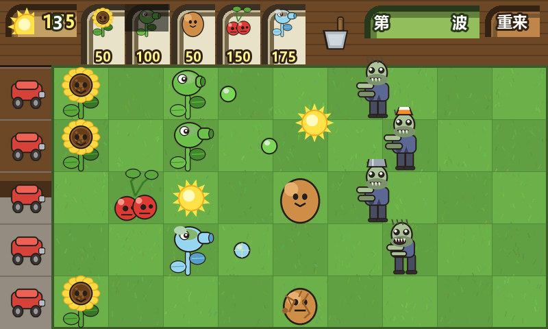
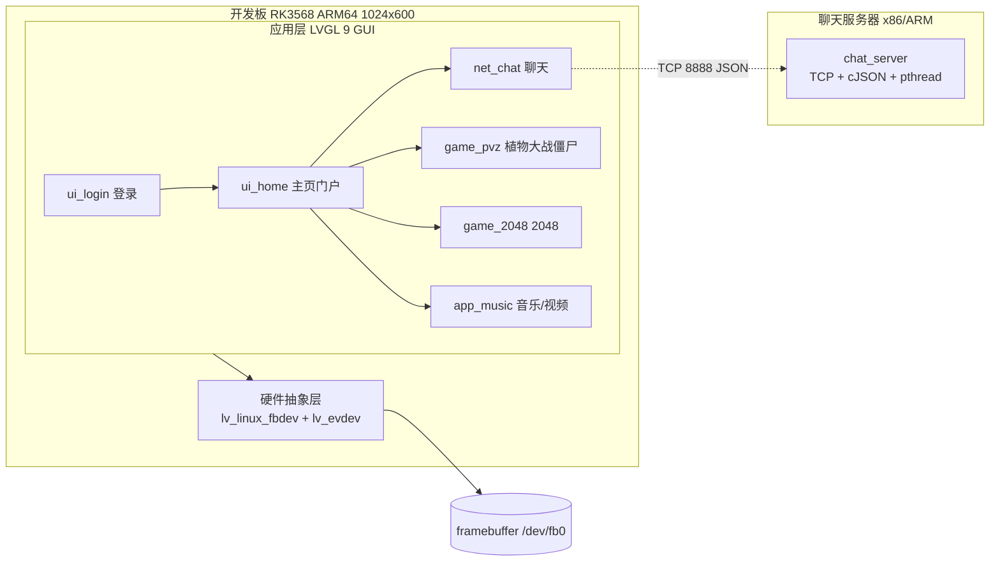

# smartterm

> 基于 RK3568（ARM64）开发板的嵌入式 Linux 智能终端 —— 登录鉴权、网络聊天、经典小游戏（植物大战僵尸 / 2048）与音乐视频播放，统一用 LVGL 9 做图形界面，像一台「迷你掌上终端」。
>
> 代码在 x86 虚拟机里用 `aarch64-linux-gnu-gcc` 交叉编译，部署到板端 `/jing/main` 直接运行；网络通信走本地 TCP 聊天服务器（admin/1234）。

## 项目简介

**一句话**：一个跑在 ARM 开发板上的嵌入式智能终端，用户登录后可在同一块 1024×600 触摸屏上使用「网络聊天 / 植物大战僵尸 / 2048 / 音乐视频」四大功能，全部模块共享同一套 LVGL 图形框架与 TCP 通信层。

本人在从零独立搭建：用 **C + LVGL 9** 完成全部图形界面与业务逻辑，用 **TCP Socket + cJSON + pthread** 实现网络聊天与登录鉴权，用 **fork + mplayer -slave + 命名管道** 实现音乐/视频播放，最终通过 **CMake + aarch64 交叉编译** 部署到 **RK3568（ARM64）** 开发板，在 1024×600 触摸屏上实际运行。

**界面预览**

下图是植物大战僵尸模块在板端 LVGL 渲染的真实预览（其余模块为同套框架绘制）：

[](docs/screenshots/pvz_preview.png)

## 核心功能

| 模块 | 技术含量 | 一句话讲法 |
| --- | --- | --- |
| **登录鉴权** | 中 | 触摸键盘输入，登录请求以「4 字节长度头 + JSON」封包发往服务器校验 |
| **网络聊天室** | 高 | TCP 长连接 + cJSON 协议，pthread 每连接一线程、互斥锁保护在线链表；跨线程经 `lv_async_call` 安全刷新 UI |
| **植物大战僵尸** | 高 | 数据驱动横版塔防，对象池管理僵尸/植物，30ms 定时器驱动，5 波递增 + 僵尸王 |
| **2048** | 中高 | 4×4 棋盘，触摸滑动手势控制方向，纯 LVGL 控件绘制（零图片素材），分数/最高分/胜负遮罩 |
| **音乐 / 视频** | 高 | fork + mplayer -slave + FIFO 控制，自动扫描 `/jing/music` 与 U 盘；播放时让 LVGL 暂停刷新以释放 framebuffer |

## 技术栈

| 类别 | 选型 |
| --- | --- |
| 编程语言 | C（C99）、少量 C++（CMake 工程） |
| GUI 框架 | LVGL 9（轻量级开源嵌入式图形库） |
| 硬件平台 | RK3568 开发板，四核 Cortex-A55，1024×600 电容触摸屏 |
| 操作系统 | Linux（framebuffer `/dev/fb0` 显示 + evdev `/dev/input/eventX` 触摸输入） |
| 网络通信 | TCP Socket、cJSON 协议封装、pthread 多线程并发 |
| 进程与并发 | fork 创建子进程、waitpid 回收、命名管道（FIFO）进程间通信 |
| 多媒体 | mplayer（`-slave` 从模式 + FIFO 命令控制） |
| 构建与部署 | CMake、aarch64-linux-gnu-gcc 交叉编译、板端直接运行 |

## 系统架构



**构建链路**：源码 → `aarch64-linux-gnu-gcc` 交叉编译（CMake）→ 产物 `bin/main`（≈2.3 MB）→ 经 rz / adb / U 盘传至开发板 `/jing/main` 直接运行。

**数据流（聊天）**：

```
登录: ui_login --"4字节长度+JSON"--> chat_server --校验--> 返回 {id,name}
聊天: net_chat 收包线程 --lv_async_call--> 主线程刷新列表/消息
```

## 目录结构

```
smartterm/
├── CMakeLists.txt          # 交叉编译配置（aarch64-linux-gnu-gcc），aux_source_directory 自动收 mysrc/src
├── Makefile                # 备选构建
├── main.c                  # 入口：fbdev + evdev 初始化、主循环（music/video 时暂停 LVGL 刷新）
├── lv_conf.h               # LVGL 配置（含 A: 盘符映射板子根 /）
├── lv_my_font.h         # 自定义字体
├── mouse_cursor_icon.c     # 鼠标光标图标
├── mysrc/
│   ├── inc/                # 模块头文件（ui_login/ui_home/net_chat/game_pvz/game_2048/app_music/game_menu/cJSON）
│   └── src/                # 对应实现 + cJSON.c
├── server/                 # 聊天服务器（chat_server.c + cJSON + Makefile）
├── tools/                  # Python 资源生成/校验（gen_pvz_res.py 等）
├── lvgl/                   # LVGL 9 源码（add_subdirectory 编入）
├── pvzBMP/                 # 38 张 PVZ BMP 美术资源（板端 /jing/pvzBMP）
├── docs/screenshots/       # 运行预览图
├── README_上板部署.md       # 上板全流程（编译/传板/资源布局/关出厂demo/运行/排错）
├── README_PVZ.md           # 植物大战僵尸模块设计文档
├── .gitignore
├── DEVELOPMENT.md               # 已知坑与防坑手册（上下文）
├── ROADMAP.md              # 迭代计划
└── LICENSE                 # MIT
```

## 构建与运行

**环境要求**

- LVGL 9 源码已含于仓库 `lvgl/`
- 交叉编译器：`aarch64-linux-gnu-gcc`（本项目 CMakeLists 写死 `/usr/local/arm-linux/bin/` 路径，按你的工具链改 `CMAKE_C_COMPILER` 即可）
- 板端需预装 `mplayer`（`which mplayer` 确认）

### 1. 编译客户端（Ubuntu 虚拟机 / x86 宿主机）

```sh
cd build
cmake ..
make
# 产物：bin/main（aarch64 动态链接，≈2.3 MB）
```

> 若在 VMware 共享目录（HGFS）下构建出现 `检测到时钟错误` 属时间戳偏差，无害。
> 改源码后 `make` 不重编：`touch mysrc/src/*.c && make`。

### 2. 编译并运行聊天服务器

```sh
cd server
make                 # cc chat_server.c cJSON.c -o chat_server -lpthread
./chat_server        # 监听 8888，预置账号 admin/1234
```

### 3. 部署到开发板（见 README_上板部署.md 完整版）

```sh
# 传 main 到板子 /jing/main（rz / adb push / U 盘任选）
mkdir -p /jing/pvzBMP /jing/music
# 把 pvzBMP/ 整目录放到 /jing/pvzBMP，音乐平铺到 /jing/music/
# 关掉出厂 demo 自启
mount -o remount,rw /
chmod -x /etc/init.d/S50launch_demo
sync && reboot
# 运行
cd /jing && ./main
```

登录界面 Server 填服务器 IP（默认 `192.168.1.100`，改 `ui_login.c` 的 `SERVER_IP_DEFAULT`），账号 `admin/1234`。

## 实现难点与亮点

- **一屏多程序抢显存（framebuffer）**：所有程序共用 `/dev/fb0`。播放视频时让 LVGL 主循环暂停刷新，避免界面不断重绘盖掉视频；视频结束自动恢复——解决了「视频放不出来」的问题。
- **SIGPIPE 杀进程**：早期 mplayer 子进程 stdout 接无读端管道，连接关闭触发 SIGPIPE 把播放器打死。改为把子进程 stdout 重定向到 `/dev/null` 后稳定。
- **触摸键盘常显**：LVGL 内置键盘默认隐藏、需上滑才出，体验差。改为建好即常显并立即 `lv_refr_now` 重绘 + 清滚动标志，贴合嵌入式无实体键盘场景。
- **触摸滑动手势（2048）**：用 PRESSED/RELEASED 两点位移判定方向，完全摆脱实体键盘。
- **TCP 粘包处理**：客户端/服务器统一「4 字节长度前缀（网络字节序）+ JSON 体」，接收方按长度收全，解决流式传输的粘包/拆包。
- **出厂镜像抢占屏幕**：板子自带测试 demo 开机自启长期占屏，通过关闭 `/etc/init.d/S50launch_demo` 让自有程序独占显示。
- **跨平台交叉编译**：在 x86 虚拟机用 aarch64 工具链编译，再部署到 ARM 板，走通「宿主机编译—目标机运行」完整流程。

## 开发约定

- 板端资源路径固定：`A:/jing/pvzBMP`（PVZ）、`/jing/music`（音乐，U 盘 `/mnt/usb` 优先）、聊天服务器 `127.0.0.1:8888`
- 新增源文件放进 `mysrc/src/`，`CMakeLists.txt` 的 `aux_source_directory` 自动编入，无需改构建
- LVGL 对象**禁止跨线程操作**：所有 UI 刷新经 `lv_async_call` 回到主线程
- 触摸节点名按板子实际写死（如 `event6`），换板需核对 `/dev/input/event*`
- 提交前在板端实测：登录键盘、聊天收发、PVZ 资源加载、2048 手势、音乐/视频出画

## Roadmap

> 完整迭代计划见 [ROADMAP.md](ROADMAP.md)。已完成：

- v0.1 登录鉴权 + 主页门户
- v0.2 网络聊天室（TCP + cJSON + 多线程）
- v0.3 植物大战僵尸（对象池 + 波次 + 僵尸王）
- v0.4 音乐/视频播放（fork + mplayer -slave，fb0 释放）
- v0.5 2048 小游戏（纯 LVGL 绘制 + 滑动手势）
- v0.6 工程化：关出厂 demo、资源路径板端化、README/文档体系

**规划中**

- 截图/录屏补进 `docs/screenshots/`，丰富 README 预览
- 聊天支持历史消息落盘
- 用 CMake 预设区分「板端交叉编译」与「x86 本机仿真」

## 许可

[MIT](LICENSE) © 2026 Y71jj123
